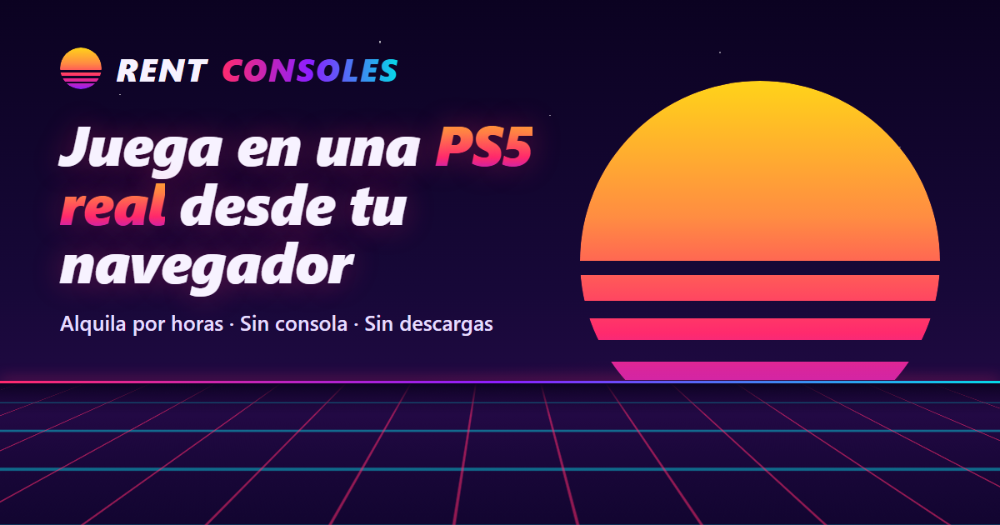
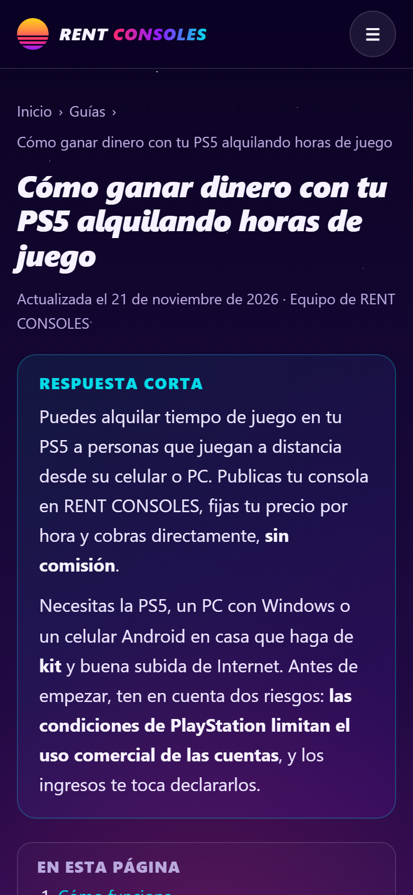
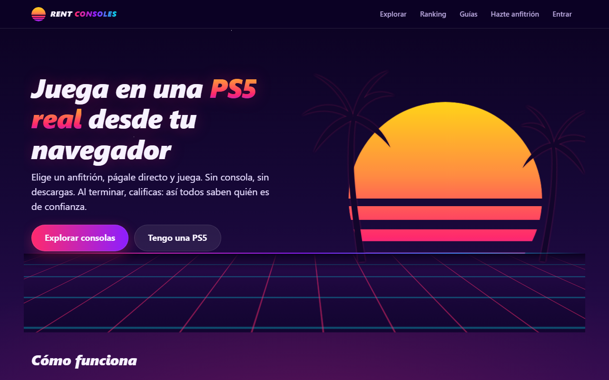

  

# RENT CONSOLES

**Juega en una PS5 real desde el navegador del celular o del PC. O gana dinero alquilando horas de juego en la tuya.**

[rentconsoles.com](https://rentconsoles.com) · [Publicar mi PS5](https://rentconsoles.com/panel) · [Explorar consolas](https://rentconsoles.com/explorar) · [Guías](https://rentconsoles.com/guias) · [X @rentconsoles](https://x.com/rentconsoles)

RENT CONSOLES es una web que conecta a dueños de una PS5 («anfitriones») con personas que quieren jugar en ella a distancia («jugadores»):
- el jugador alquila de 15 minutos a 2 horas;
- paga directamente al anfitrión;
- juega desde el navegador del celular o del PC, sin descargar nada.

> Este repositorio es la presentación del proyecto. El servicio funciona en **[rentconsoles.com](https://rentconsoles.com)**.

---

## ¿Tienes una PS5? Gana dinero con ella

Tu consola sigue en tu casa y tú pones el precio por hora. Un jugador la elige en la web, te paga por transferencia o en Bitcoin y, cuando confirmas que el dinero llegó, juega en ella durante el tiempo que pagó. **RENT CONSOLES no cobra comisión:** lo que pagan es para ti.

### Qué necesitas

- **Una PS5** actualizada, con «Uso a distancia» activado.
- **Un kit en tu casa:** un PC con Windows, o un celular o tablet Android 8 o posterior con la app RENT CONSOLES Kit, en la misma red que la PS5.
- **Buena subida de Internet:** unos 5 Mbps por partida; mejor 15 Mbps y la PS5 por cable.
- **Un usuario de PS5 dedicado** al alquiler, sin tarjeta ni saldo guardados.
- **Una forma de cobrar:** cuenta bancaria (para jugadores de tu país) o dirección de Bitcoin (para cualquier país).

### Cómo empezar

1. Crea tu cuenta y entra en **[Hazte anfitrión](https://rentconsoles.com/panel)**.
2. Escribe el nombre de tu consola, tu ciudad, tus juegos, tu precio por hora y cómo cobras.
3. Descarga el kit y vincúlalo con el código o el QR que te muestra la web.
4. Cuando alguien pague, revisa tu banco o tu cartera y pulsa **PAGO RECIBIDO**. Sin pago confirmado, la partida no empieza.

### Cuánto puedes ganar

**Precio por hora × horas alquiladas.** Sin comisión.

| Precio por hora | Horas alquiladas al mes | Ingreso al mes |
|---|---|---|
| 1 USD | 20 | 20 USD |
| 2 USD | 40 | 80 USD |
| 3 USD | 60 | 180 USD |

*Son ejemplos, no promesas.* RENT CONSOLES es un proyecto nuevo y todavía tiene pocos jugadores. Tómalo como un ingreso extra posible, no como un sueldo.

### Lo que debes saber antes

- **Condiciones de PlayStation:** limitan las cuentas a un uso personal y no comercial. Alquilar el uso de tu consola puede incumplirlas, y Sony podría restringir o suspender tu cuenta. Es un riesgo que asumes tú.
- **Impuestos:** lo que cobras son ingresos tuyos; infórmate de cómo declararlos en tu país.
- **Costes:** luz (una PS5 jugando consume unos 200 W), datos (unos 2 GB de subida por hora de partida) y horas de uso de la consola.

Guía completa: **[Cómo ganar dinero con tu PS5](https://rentconsoles.com/guias/como-ganar-dinero-con-tu-ps5)**.

---

## ¿Quieres jugar sin tener consola?

1. Entra en **[Explorar](https://rentconsoles.com/explorar)** y elige una consola por su reputación, sus juegos y su precio.
2. Elige 15, 30, 60, 90 o 120 minutos.
3. Paga al anfitrión por transferencia (si estás en su país) o en Bitcoin, y sube el comprobante.
4. Cuando el anfitrión confirma el pago, juegas en Chrome, Edge o Safari. El tiempo empieza a contar cuando llega la imagen.
5. Al terminar, calificas al anfitrión.

**Así se juega:** a 720p y 30 fps, con mando por USB o Bluetooth, controles táctiles o teclado. Gasta unos 2 GB por hora. Qué juegos hay depende de lo que tenga cada anfitrión.

---

## Seguridad y confianza

- **Sin intermediario en el dinero:** el jugador paga al anfitrión y la partida solo empieza cuando el anfitrión confirma el pago.
- **Reputación real:** estrellas y etiquetas («sin cortes», «poco retraso») de quienes jugaron. Hay un [ranking](https://rentconsoles.com/ranking) de los mejores.
- **Reclamos revisados por personas:** si pagaste y no pudiste jugar, tienes 7 días para reclamar. Los reclamos confirmados bajan la reputación del anfitrión.
- **La red del anfitrión, protegida:** no se abren puertos en su router y el video viaja cifrado por un relay de Cloudflare. El jugador no ve la IP de su casa.
- **Sin grabaciones:** la imagen no pasa por los servidores de RENT CONSOLES ni se guarda.

---

## Preguntas frecuentes

**¿Cuánto cobra RENT CONSOLES?**
Nada. Los jugadores pagan directamente al anfitrión.

**¿Funciona en iPhone?**
Sí, en Safari actualizado. También en Android (Chrome o Edge) y en PC.

**¿Necesito mando?**
No es obligatorio: hay controles táctiles en el celular y teclado en el PC. Con mando se juega mejor.

**¿Desde qué países se puede jugar?**
Desde cualquiera. Con Bitcoin se paga a un anfitrión de cualquier país; la transferencia solo entre personas del mismo país. Cuanto más cerca esté la consola, menos retraso.

**¿Se puede jugar GTA 6 en el celular?**
GTA 6 solo existe para PS5 y Xbox Series. En el celular se juega a distancia en una consola que lo tenga. Toda «GTA 6 APK» es falsa. Más en [esta guía](https://rentconsoles.com/guias/como-jugar-gta-6-en-el-celular).

---

## Guías

- [Qué es RENT CONSOLES y cómo funciona](https://rentconsoles.com/como-funciona)
- [Cómo ganar dinero con tu PS5 alquilando horas de juego](https://rentconsoles.com/guias/como-ganar-dinero-con-tu-ps5)
- [Cómo jugar juegos de PS5 en el celular o en PC, con o sin consola](https://rentconsoles.com/guias/como-jugar-juegos-de-ps5-en-el-celular)
- [Cómo jugar GTA 6 en el celular, en PC o sin consola](https://rentconsoles.com/guias/como-jugar-gta-6-en-el-celular)
- [Ganar dinero sin salir de casa: opciones reales y cómo evitar estafas](https://rentconsoles.com/guias/ganar-dinero-sin-salir-de-casa)

---

## Estado del proyecto

RENT CONSOLES es un **prototipo en funcionamiento**, con sede en Paraguay. Puede tener interrupciones y todavía hay pocas consolas publicadas: si tienes una PS5, eres justo lo que falta.

**Contacto:** [Ayuda y contacto](https://rentconsoles.com/ayuda) en la web, o [@rentconsoles](https://x.com/rentconsoles) en X.

---

RENT CONSOLES no tiene relación con Sony Interactive Entertainment, Microsoft, Rockstar Games ni Take-Two. PS5, PlayStation, Xbox y Grand Theft Auto son marcas de sus dueños. © 2026 RENT CONSOLES. Textos e imágenes de este repositorio: todos los derechos reservados.
